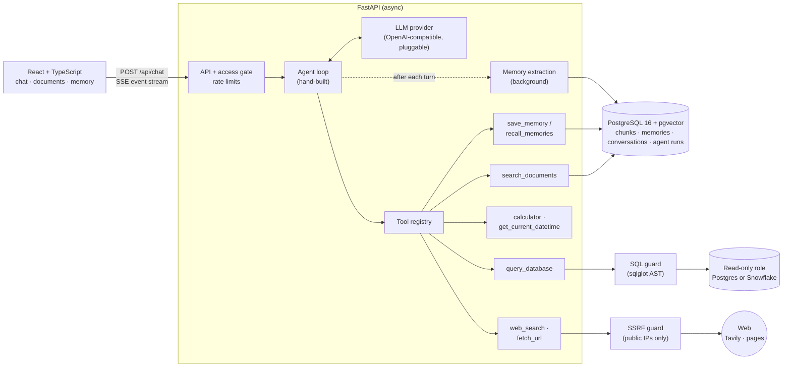

# Recall

**An AI agent with tools, RAG over your documents, safe natural-language SQL, web
search, and long-term memory, built from scratch (no LangChain, no LlamaIndex).**

[](https://github.com/reuelskoshy/recall-agent/actions/workflows/ci.yml)
· **Live demo:** https://recall-s9qe.onrender.com (password-protected; ask me for access.
The free tier sleeps when idle, so the first load takes about a minute.)

Ask it a question and it decides which tools to call, shows every step while it
streams the answer, and remembers what you told it in earlier conversations:

- *"What does the handbook say about carrying over leave?"* → searches uploaded documents, answers with citations
- *"Which 3 customers have the highest total invoice amount?"* → writes SQL, validates it, runs it read-only, shows the query and the table
- *"What changed in the latest pgvector release?"* → searches the web, reads the release page, links its sources
- *"Remember that I prefer answers in bullet points."* → saved to long-term memory and applied in every later conversation

## Architecture



### One agent turn

1. **Context.** Load recent history, plus the user's *core* memories (instructions and anything rated important) and the top-ranked memories relevant to the message.
2. **Loop.** Stream the model's reply. If it requests tools, run them concurrently, each with a timeout and capped output, feed the results back, and repeat, up to a fixed iteration budget. The final iteration gets no tools, so the loop always ends with an answer.
3. **Stream.** Every step reaches the browser as typed SSE events (`token`, `tool_call`, `tool_result`, `memories`, `done`), so the UI renders tool cards live.
4. **Record.** Each run is stored with per-step latency, token usage, tool inputs and outputs, and the memories it used (`GET /api/runs/{id}`).
5. **Learn.** In the background, an extraction pass decides whether the turn revealed anything worth remembering.

## Features and design decisions

### RAG over documents
- Upload PDF, Markdown or text. Text is split along section headings into overlapping chunks, embedded locally with `BAAI/bge-small-en-v1.5` (sentence-transformers) and stored in pgvector (HNSW index).
- **Hybrid retrieval.** Vector similarity and Postgres full-text search are fused with Reciprocal Rank Fusion. Embeddings catch meaning ("vacation" ≈ "annual leave"), while keyword search catches exact names and numbers.
- **Relevance gate.** A chunk counts only if it clears a calibrated similarity threshold or matches by keyword. When nothing does, the agent says it doesn't know instead of guessing.
- Answers cite the file, page and section.

### Natural-language SQL, safe by construction
The model writes SQL against a sample company dataset (7 tables, 1,235 rows: employees, customers, orders, invoices and more). Safety comes in layers, because the model is never trusted:
1. **Syntax-tree validation** (sqlglot, dialect-aware). Only a single `SELECT` over allow-listed tables is accepted. Functions that leak system state or have side effects (`pg_*`, `dblink`, `set_config`, Snowflake `system$*`, `result_scan`, …) are rejected. The executed SQL is re-rendered from the validated tree, not passed through as text.
2. **A least-privilege database role**, which is the real boundary. It may only `SELECT` the dataset schema; its sessions are read-only by default and have a statement timeout.
3. **Limits.** Per-query timeout and row cap; results are truncated (and flagged as such) before reaching the model.

The same tool runs on **PostgreSQL or Snowflake** behind a `SqlBackend` interface, selected by one env var. The Snowflake backend uses key-pair auth with a dedicated read-only service user. Both return identical answers on the same dataset. With the guard bypassed, the read-only role still refused `DELETE`, `CREATE`, role switching and account-usage queries.

### Web search and page reading
- `web_search` queries Tavily, a search API built for agents, behind a `SearchProvider` interface. `fetch_url` downloads a page and extracts its readable text, dropping scripts, menus and footers.
- **SSRF protection.** The model chooses the URLs, so a malicious page or prompt could aim it at `localhost`, the private network, or the cloud metadata service (`169.254.169.254`). The check lives in a custom network backend under the HTTP client:
  - it resolves the hostname and refuses unless *every* address is public, including IPv4 hidden inside IPv6 forms;
  - it then connects to exactly the IP it checked, which defeats DNS rebinding while TLS still verifies the real hostname;
  - every redirect hop passes through the same check, and only ports 80 and 443 are allowed.
- **Prompt injection.** Web text reaches the model fenced as untrusted data, and the system prompt forbids following instructions found inside it. The real safety net is that no tool can cause harm: SQL is read-only and fetching is restricted to public addresses.
- **Limits:** a download cap, a text cap, timeouts, text content types only, and an honest user-agent. Answers cite web facts as Markdown links, and links render only for `http(s)` URLs.
- `web_search` registers only when an API key is configured; `fetch_url` needs no key.

### Long-term memory
- Memories are short facts about the user ("The user prefers …") with a kind (fact, preference, instruction) and an importance from 1 to 5.
- **Ranking:** `score = 0.7·relevance + 0.2·recency + 0.1·importance`, where:
  - relevance is cosine similarity rescaled above a floor;
  - recency halves every 30 days since the memory was last *used*;
  - weights are configurable.
- Instructions and highly important memories are always included; the rest compete for 5 slots.
- **Write path hygiene:**
  - near-duplicates (≥ 0.9 similarity) update the existing memory instead of adding one;
  - likely contradictions are reported back to the model so it can `replace` the old memory;
  - anything that looks like a secret is refused.
- **Two ways in:** the model can call `save_memory` explicitly, and a background extraction pass after each turn catches what it didn't save. The extraction prompt forbids saving guesses inferred from requests.
- The Memory page shows, searches, edits and deletes memories. Each answer shows which memories were used.

### Engineering
- **Pluggable everything:**
  - LLM providers: any OpenAI-compatible API, plus a scripted fake for tests.
  - Embedders.
  - SQL backends.
  - Tools: one class plus a JSON schema each, auto-registered.
- **Async throughout:** FastAPI, SQLAlchemy 2 async + asyncpg, Alembic migrations, Pydantic v2 settings.
- **Tests:** 285 automated tests (274 pytest, 11 Vitest), covering the agent loop with a scripted LLM, the SQL guard's attack cases, SSRF and prompt-injection cases for the web tools, memory ranking, the API, and deployment protections. Tests run against a real Postgres + pgvector, not mocks.
- **Evaluation:** an end-to-end eval ([backend/evals](backend/evals/README.md)) sends 15 questions through the real API and scores retrieval hit rate, tool routing, and answer correctness with deterministic checks. It scored **100% on all 14 runnable cases in two consecutive runs** (retrieval MRR 0.93–1.0), with web search skipped because no key was configured.
- **CI/CD:** GitHub Actions runs ruff, mypy (strict), pytest, ESLint, Vitest and the TypeScript build. Render deploys only after CI passes.
- **Public demo hardening:**
  - a shared-password gate using HMAC tokens;
  - per-IP sliding-window rate limits plus a daily cap, to bound LLM spend;
  - client IP read from trusted proxy hops only, because `X-Forwarded-For` is spoofable.

## Tech stack

| Layer | Choices |
|---|---|
| Backend | Python 3.12, FastAPI, SQLAlchemy 2 (async), Alembic, Pydantic v2 |
| Data | PostgreSQL 16 + pgvector; Snowflake (optional SQL backend) |
| AI | OpenAI-compatible chat API (IFM K2-Horizon in the demo), sentence-transformers `bge-small-en-v1.5`, sqlglot, Tavily web search |
| Frontend | React, TypeScript (strict), Vite, SSE streaming |
| Ops | Docker, Docker Compose, GitHub Actions, Render, Neon |

## Run locally

Requires Docker and an API key for any OpenAI-compatible LLM.

```bash
cp .env.example .env    # set LLM_API_KEY (and LLM_BASE_URL / LLM_CHAT_MODEL if not OpenAI)
docker compose up --build
```

Open http://localhost:5173. Migrations, the read-only role and the sample dataset are set up on start. Upload `samples/acme-employee-handbook.md` on the Documents page to try RAG.

### Tests

```bash
docker compose up -d db
cd backend && uv sync && uv run pytest     # backend (uses a separate test database)
cd frontend && npm ci && npm test          # frontend
```

## Project layout

```
backend/app/
  agent/      agent loop, system prompt, SSE event types
  llm/        provider interface, OpenAI-compatible provider, scripted fake
  tools/      tool registry + calculator, datetime, search_documents, query_database, web, memory tools
  web/        search providers, page fetching and text extraction, SSRF guard
  rag/        extraction, chunking, embeddings, hybrid retrieval, ingestion
  sql/        guard (sqlglot), executor, Postgres + Snowflake backends
  memory/     short-term history, long-term ranking, background extraction
  datasets/   sample company dataset, seeding, Snowflake setup script
  api/        chat (SSE), documents, memories, runs, tools, auth, health
frontend/src/ chat UI with live tool traces, documents and memory pages
deploy/       production entrypoint and deployment guide
```

## Deployment

Production is a single Docker image: the API, the built frontend and the embedding model, baked in so there's no download at startup. On boot it migrates, provisions the read-only role, seeds the dataset and the sample handbook (all idempotent), then serves. The live demo runs on Render with Neon Postgres; see [deploy/DEPLOY.md](deploy/DEPLOY.md).

## Limitations and future work

- **Single shared workspace.** There are no user accounts, so all demo visitors share conversations and memory. Per-user isolation would add a `user_id` to conversations, documents and memories.
- **Connect your own database.** Point `query_database` at a user-supplied database, with schema introspection, a check that the credentials are truly read-only, and schema retrieval for large databases.
- **Eval in CI.** Run the eval suite on every change to the prompt or retrieval settings (it needs an LLM key, so it isn't in the default CI job), and grow it with harder multi-step questions.
- **Rate limits are in-process**, which is fine for one instance; several replicas would need Redis.
